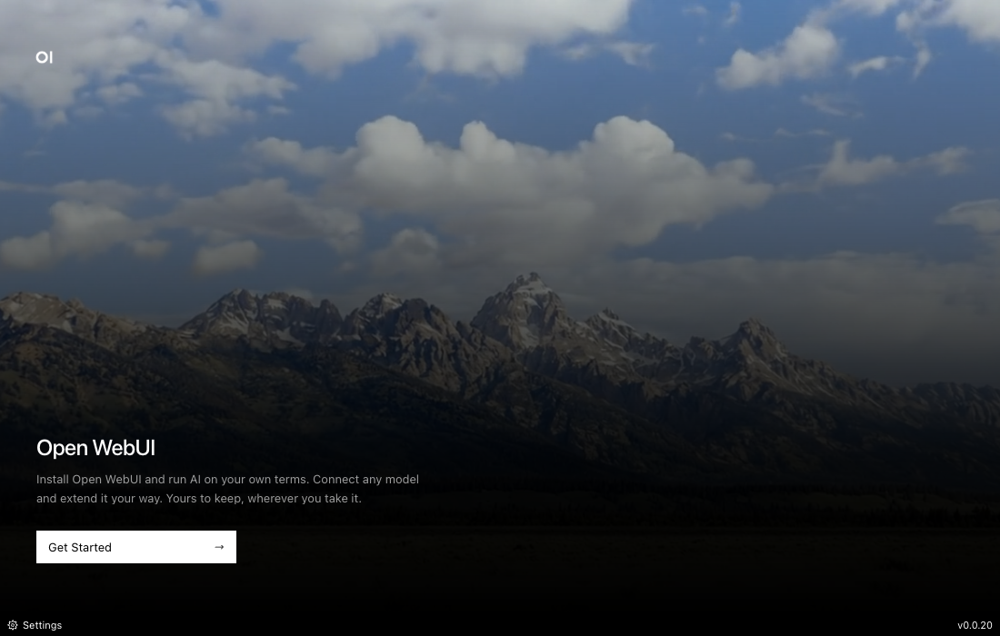

# Open WebUI Desktop

[](https://github.com/open-webui/desktop/releases)
[](https://github.com/open-webui/desktop/releases)
[](https://discord.gg/open-webui)
[](LICENSE)



[Open WebUI](https://github.com/open-webui/open-webui), up and running in a few clicks. Desktop installs it on your computer, keeps it up to date, and opens it whenever you need it.

## Download

- **macOS:** [Apple Silicon](https://github.com/open-webui/desktop/releases/latest/download/open-webui-arm64.dmg) · [Intel](https://github.com/open-webui/desktop/releases/latest/download/open-webui-x64.dmg)
- **Windows:** [Intel / AMD (x64)](https://github.com/open-webui/desktop/releases/latest/download/open-webui-x64-setup.exe) · [ARM64](https://github.com/open-webui/desktop/releases/latest/download/open-webui-arm64-setup.exe)
- **Linux (Debian / Ubuntu / Mint):** [Intel / AMD (x64)](https://github.com/open-webui/desktop/releases/latest/download/open-webui_amd64.deb) · [ARM64](https://github.com/open-webui/desktop/releases/latest/download/open-webui_arm64.deb)
- **Linux (AppImage):** [Intel / AMD (x64)](https://github.com/open-webui/desktop/releases/latest/download/open-webui_x86_64.AppImage) · [ARM64](https://github.com/open-webui/desktop/releases/latest/download/open-webui_arm64.AppImage)

If an AppImage fails to start with a `chrome-sandbox` error on Debian, Ubuntu, or Linux Mint, install the `.deb` package above. Its installer configures the sandbox permissions needed to start the app.

Snap and Flatpak packages are available on the [releases page](https://github.com/open-webui/desktop/releases).

Internet is required for installation and updates.

Enable **Automatic desktop updates** in **Settings → About** to update on quit.

## How It Works

Open the app and click **Get Started**. Desktop installs Open WebUI on your computer, starts it for you, and opens it in the app. You use the same Open WebUI you know, with setup and updates handled through Desktop.

Desktop runs your own local copy of Open WebUI. If you already use Open WebUI on another server, [Open WebUI Tether](https://github.com/open-webui/tether) is a companion app that extends what you can do with it.

## System Requirements

| | Requirements |
|--|-------------|
| **Disk** | 5 GB+ |
| **OS** | macOS 12+, Windows 10+, modern Linux (glibc 2.28+) |

## Privacy

Desktop does not collect usage data. If you connect Open WebUI to an external AI provider, that provider's privacy policy applies.

## Community

- 💬 [Discord](https://discord.gg/open-webui) - Come hang out
- 🐛 [Issues](https://github.com/open-webui/desktop/issues) - Report bugs or request features
- 🌐 [Open WebUI](https://github.com/open-webui/open-webui) - The main project
- 📖 [Docs](https://docs.openwebui.com) - Full documentation

## Contributing

```bash
npm install
npm run dev
```

See [CHANGELOG.md](CHANGELOG.md) for release history. Licensed under [AGPL-3.0](LICENSE).
